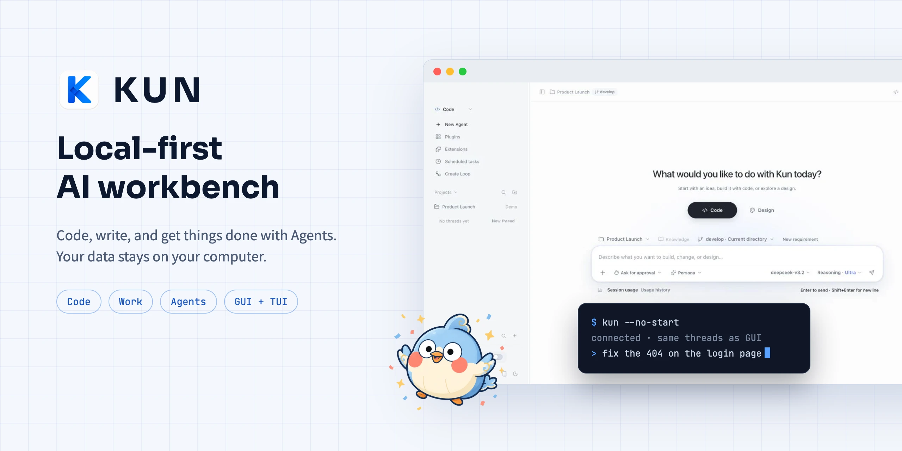
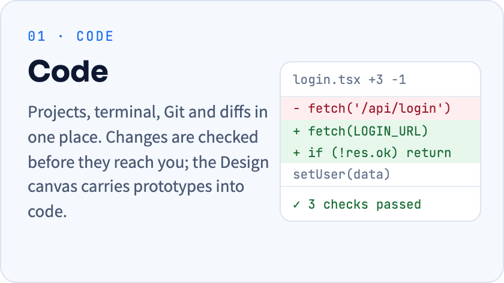
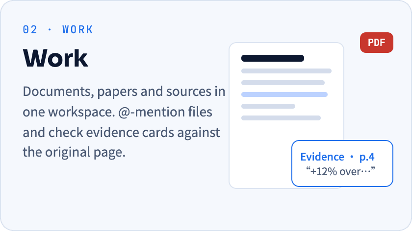
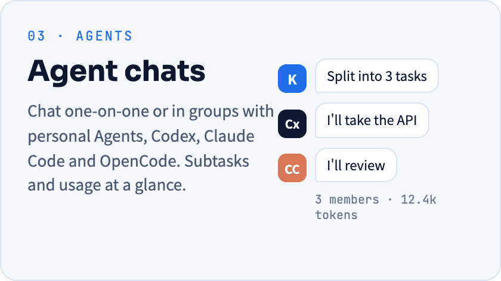
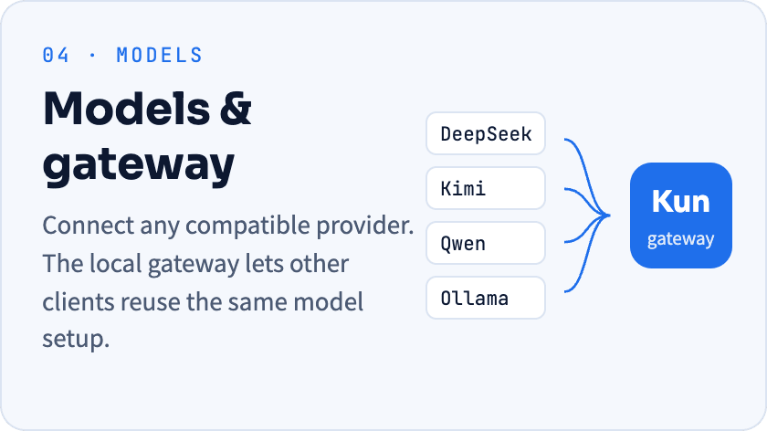
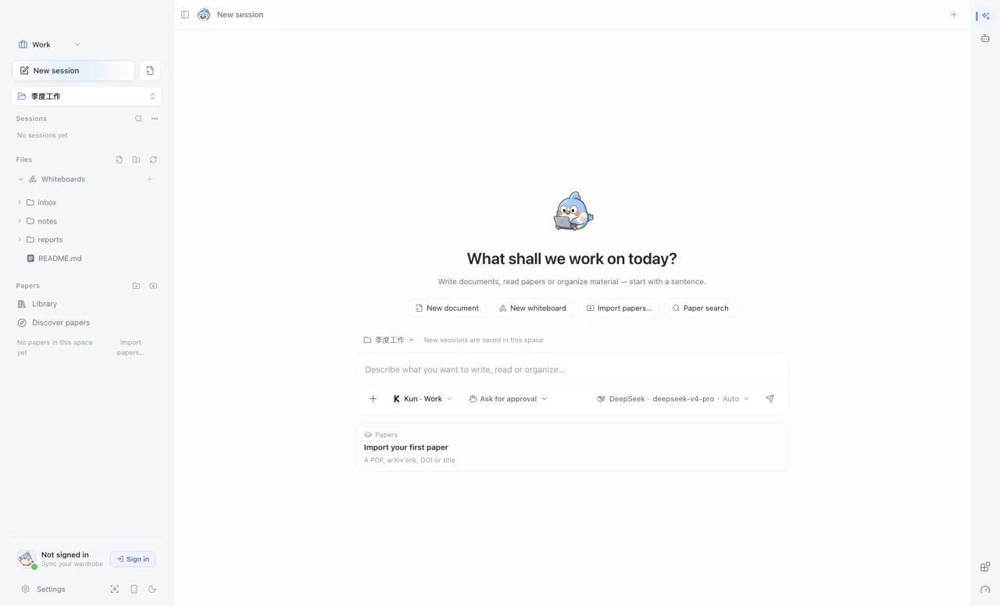

<p align="center">
  
</p>

<h1 align="center">Kun</h1>

<p align="center">
  A local-first AI workbench: write code, work on documents, and get things done with Agents.
</p>

<p align="center">
  <a href="https://github.com/KunAgent/Kun/releases">Download</a>
  &nbsp;·&nbsp;
  <a href="https://www.kun-agent.com/docs">Docs</a>
  &nbsp;·&nbsp;
  <a href="./release/release-v0.4.0.md">Changelog</a>
  &nbsp;·&nbsp;
  <a href="./README.md">中文</a>
</p>

<p align="center">
  <a href="https://github.com/KunAgent/Kun/releases"></a>
  
  <a href="./LICENSE"></a>
</p>

<p align="center">
  <picture>
    <source media="(prefers-color-scheme: dark)" srcset="./docs/assets/readme/hero-dark.en.webp">
    
  </picture>
</p>

## What Kun does

Kun is a desktop app that runs on your computer. Code, documents, and Agent conversations share one local runtime. Conversations, memory, and settings stay on your machine, and you bring your own models.

<table>
  <tr>
    <td><a href="docs/DESIGN_MODE.md"></a></td>
    <td><a href="docs/paper-evidence-workspace.md"></a></td>
  </tr>
  <tr>
    <td><a href="docs/code-agent-chats-and-rooms.md"></a></td>
    <td><a href="docs/provider-configuration-and-gateway.md"></a></td>
  </tr>
</table>

Also included: a plugin and skill marketplace (MCP / Skills), reminders and scheduled tasks, a terminal TUI, mobile remote access, and Kun accounts with a wardrobe. See the [0.4.0 changelog](release/release-v0.4.0.md) for the full list.

## Get started in three steps

1. **Install.** Pick the package for your platform from [Releases](https://github.com/KunAgent/Kun/releases).
2. **Connect a model.** On first launch, enter an API key or sign in to an existing subscription. OpenAI / Anthropic compatible endpoints and local models are supported; see the [provider guide](docs/model-provider-presets.md).
3. **Give it a concrete task.** Open a project folder in Code, or drop your material into Work. Agents ask for your approval before they act.

| Platform | Package | Architecture |
| --- | --- | --- |
| macOS | `.dmg` / `.zip` | Apple Silicon / Intel |
| Windows | `.exe` | x64 |
| Linux | `.AppImage` / `.deb` | x64 |

Install the Linux `.deb` with `sudo apt install ./Kun-*.deb` so apt also pulls in dependencies such as `libnotify4`; `dpkg -i` does not resolve dependencies and fails on minimal systems.

## A quick look

<table>
  <tr>
    <td align="center"><br><b>Code</b> · projects, tasks, and changes</td>
    <td align="center"><br><b>Work</b> · sources, documents, and papers</td>
  </tr>
</table>

## Local-first, you hold the permissions

- **Your data stays local.** Conversations, memory, and logs are stored on your machine. With a cloud model, only the context of each request goes to the provider you chose.
- **Approval before action.** Tool, directory, and workbench permissions ask for approval by default. Memory and group chats never widen them.
- **Swap models freely.** Presets cover DeepSeek, Kimi, GLM, Qwen, Ollama and more, plus custom providers.
- **GUI and TUI together.** One `kun serve` runtime, so threads, plans, and approvals carry across both.

## Run from source

Requires Node.js 22.19+.

```bash
git clone --branch develop https://github.com/KunAgent/Kun.git
cd Kun && npm ci && npm run dev
```

<details>
<summary>Common commands</summary>

| Command | Purpose |
| --- | --- |
| `npm run dev` | Build the runtime and start the Electron dev app |
| `npm run dev:tui` | Build the runtime and start the terminal TUI |
| `npm run typecheck` | TypeScript type checking |
| `npm run lint` | ESLint and the file-size check |
| `npm run test` | Run tests |
| `npm run build` | Production build |
| `npm run dist:mac` / `dist:win` / `dist:linux` | Build platform installers |

</details>

<details>
<summary>Two ways to use the terminal TUI</summary>

Keep the desktop app running and connect to its runtime from a project directory, sharing threads and approvals with the GUI:

```bash
kun --no-start
```

To use the TUI alone, quit the desktop app first and run `kun`; the TUI starts its own runtime and stops it on exit. See the [Kun TUI guide](docs/kun-tui.en.md).

</details>

## Documentation

| | |
| --- | --- |
| **Getting started** | [Model providers](docs/model-provider-presets.md) · [Personal Agents and memory](docs/independent-agents.md) · [Terminal TUI](docs/kun-tui.en.md) |
| **Workbench** | [Agent chats in Code](docs/code-agent-chats-and-rooms.md) · [Design canvas](docs/DESIGN_MODE.md) · [Papers and evidence](docs/paper-evidence-workspace.md) |
| **Extending** | [MCP and Skills](docs/project-mcp-skills.md) · [Loops](docs/workflow-loop.en.md) · [Extension platform](docs/extensions/README.md) · [Local gateway](docs/provider-configuration-and-gateway.md) |
| **Development** | [Local development](docs/DEVELOPMENT.en.md) · [Runtime architecture](docs/kun-architecture.en.md) · [Contributing](docs/CONTRIBUTING.en.md) |

## Contributing

Bug fixes and improvements to the UI, runtime, providers, and docs are welcome. Target pull requests at `develop` and read the [contribution guide](docs/CONTRIBUTING.en.md) first. External contributions require accepting the [CLA](./CLA.md).

<a href="https://github.com/KunAgent/Kun/graphs/contributors">
  
</a>

## License

[PolyForm Noncommercial 1.0.0](./LICENSE), for learning, research, and noncommercial use only. Commercial use, hosted services, or integration into commercial products require separate written permission from the author.

Kun's memory architecture draws on the Thread / Memory separation and provenance ideas in the public [Nowledge Mem](https://mem.nowledge.co/docs) documentation; the implementation is independent.

<p align="center">
  <br>
  <sub>Find Kun useful? A star helps more people discover it.</sub>
</p>
