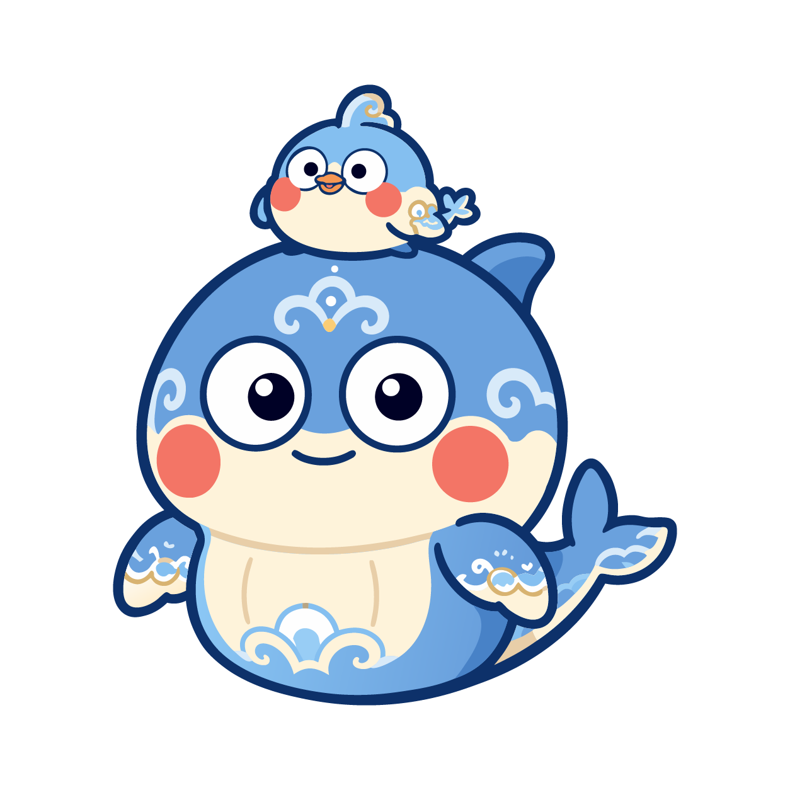
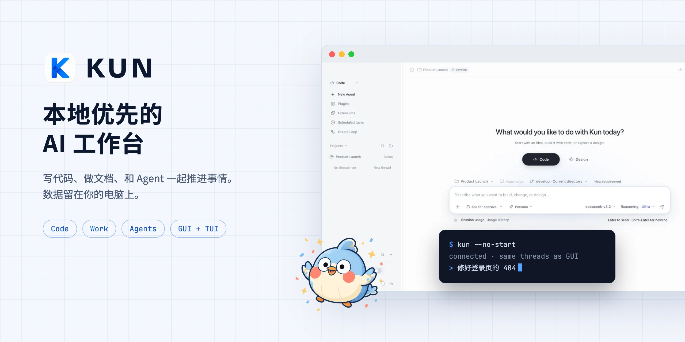
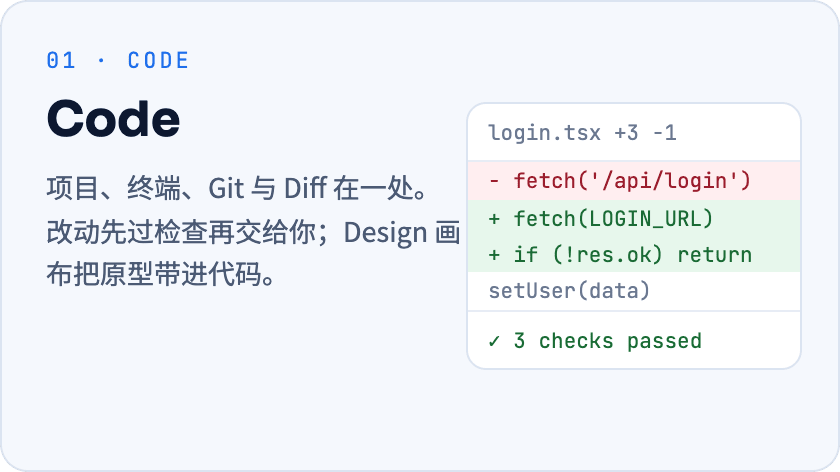
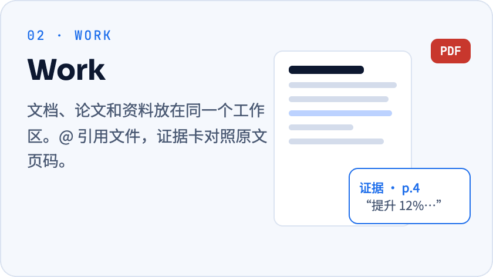
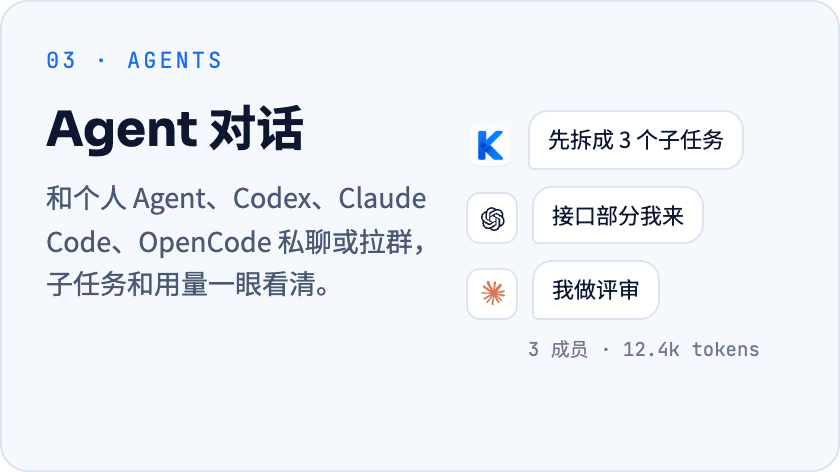
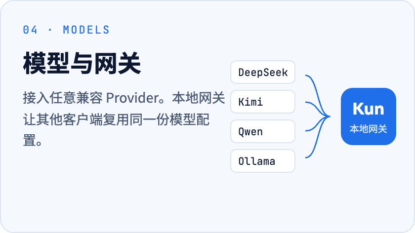
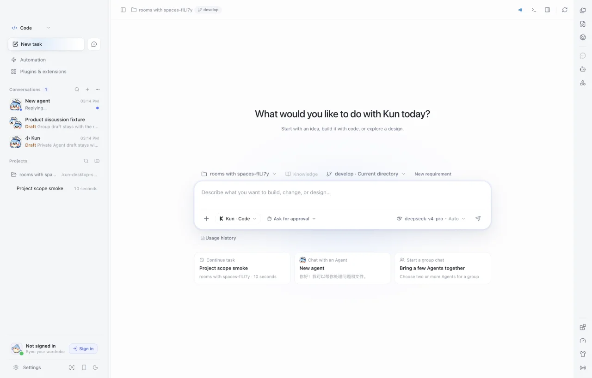
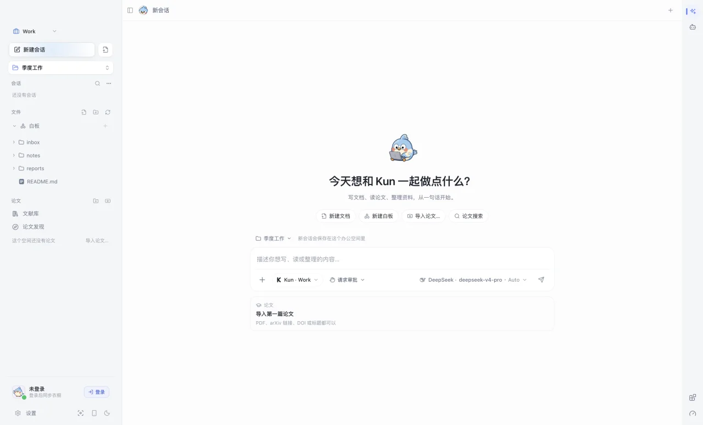

<p align="center">
  
</p>

<h1 align="center">Kun</h1>

<p align="center">
  本地优先的 AI 工作台：写代码、做文档、和 Agent 一起推进事情。
</p>

<p align="center">
  <a href="https://github.com/KunAgent/Kun/releases">下载</a>
  &nbsp;·&nbsp;
  <a href="https://www.kun-agent.com/docs">文档</a>
  &nbsp;·&nbsp;
  <a href="./release/release-v0.4.0.md">更新日志</a>
  &nbsp;·&nbsp;
  <a href="./README.en.md">English</a>
</p>

<p align="center">
  <a href="https://github.com/KunAgent/Kun/releases"></a>
  
  <a href="./LICENSE"></a>
</p>

<p align="center">
  <picture>
    <source media="(prefers-color-scheme: dark)" srcset="./docs/assets/readme/hero-dark.webp">
    
  </picture>
</p>

## Kun 能做什么

Kun 是跑在你电脑上的桌面应用。代码、文档和 Agent 对话共用一个本地运行时；会话、记忆和设置都留在本机，模型由你自己接入。

<table>
  <tr>
    <td><a href="docs/DESIGN_MODE.md"></a></td>
    <td><a href="docs/paper-evidence-workspace.md"></a></td>
  </tr>
  <tr>
    <td><a href="docs/code-agent-chats-and-rooms.md"></a></td>
    <td><a href="docs/provider-configuration-and-gateway.md"></a></td>
  </tr>
</table>

还有：插件与技能市场（MCP / Skills）、提醒与定时任务、终端 TUI、手机远程、Kun 账号与衣橱。完整列表见 [0.4.0 更新日志](release/release-v0.4.0.md)。

## 三步开始

1. **下载安装。** 从 [Releases](https://github.com/KunAgent/Kun/releases) 选择对应平台的安装包。
2. **连接一个模型。** 首次启动的引导里填 API Key，或登录已有订阅。支持 OpenAI / Anthropic 兼容接口与本地模型，见 [Provider 文档](docs/model-provider-presets.md)。
3. **给一件具体的事。** 打开一个项目文件夹交给 Code，或把资料拖进 Work。Agent 动手前会先请你确认。

| 平台 | 安装包 | 架构 |
| --- | --- | --- |
| macOS | `.dmg` / `.zip` | Apple Silicon / Intel |
| Windows | `.exe` | x64 |
| Linux | `.AppImage` / `.deb` | x64 |

Linux 的 `.deb` 请用 `sudo apt install ./Kun-*.deb` 安装，apt 会一并装上 `libnotify4` 等依赖；`dpkg -i` 不处理依赖，在精简系统上会装不上。

## 看一眼

<table>
  <tr>
    <td align="center"><br><b>Code</b> · 项目、任务与改动</td>
    <td align="center"><br><b>Work</b> · 资料、文档与论文</td>
  </tr>
</table>

## 本地优先，权限在你

- **数据在本机。** 会话、记忆、日志存在本地；用云端模型时，只有本次请求的上下文发给你选的 Provider。
- **动手先确认。** 工具、目录和工作台权限默认需要批准；记忆和群聊不会扩大权限。
- **模型随你换。** DeepSeek、Kimi、GLM、Qwen、Ollama 等预设，也可自定义 Provider。
- **GUI 与 TUI 共用。** 同一个 `kun serve` 运行时，线程、计划和审批两边都能接着用。

## 从源码运行

需要 Node.js 22.19+。

```bash
git clone --branch develop https://github.com/KunAgent/Kun.git
cd Kun && npm ci && npm run dev
```

<details>
<summary>常用命令</summary>

| 命令 | 用途 |
| --- | --- |
| `npm run dev` | 构建运行时并启动 Electron 开发环境 |
| `npm run dev:tui` | 构建运行时并启动终端 TUI |
| `npm run typecheck` | TypeScript 类型检查 |
| `npm run lint` | ESLint 与文件大小检查 |
| `npm run test` | 运行测试 |
| `npm run build` | 生产构建 |
| `npm run dist:mac` / `dist:win` / `dist:linux` | 构建对应平台安装包 |

中国大陆网络较慢时可加 `--registry=https://registry.npmmirror.com`。

</details>

<details>
<summary>终端 TUI 的两种用法</summary>

保持桌面应用运行，在项目目录连接它的运行时，与 GUI 共用线程和审批：

```bash
kun --no-start
```

单独使用时先退出桌面应用，再运行 `kun`；TUI 会启动自己的运行时，退出时一并停止。更多见 [Kun TUI 文档](docs/kun-tui.md)。

</details>

## 文档

| | |
| --- | --- |
| **上手** | [模型 Provider](docs/model-provider-presets.md) · [个人 Agent 与记忆](docs/independent-agents.md) · [终端 TUI](docs/kun-tui.md) |
| **工作台** | [Code 中的 Agent 对话](docs/code-agent-chats-and-rooms.md) · [Design 画布](docs/DESIGN_MODE.md) · [论文与证据](docs/paper-evidence-workspace.md) |
| **扩展** | [MCP 与 Skills](docs/project-mcp-skills.md) · [Loops](docs/workflow-loop.md) · [Extension 平台](docs/extensions/README.md) · [本地网关](docs/provider-configuration-and-gateway.md) |
| **开发** | [本地开发](docs/DEVELOPMENT.zh-CN.md) · [运行时架构](docs/kun-architecture.md) · [贡献指南](docs/CONTRIBUTING.zh-CN.md) |

## 参与贡献

欢迎提交 bug 修复、UI、运行时、Provider 和文档改进。PR 请以 `develop` 为目标分支，开始前读一下 [贡献指南](docs/CONTRIBUTING.zh-CN.md)；外部贡献需要签署 [CLA](./CLA.md)。

<a href="https://github.com/KunAgent/Kun/graphs/contributors">
  
</a>

## 许可证

[PolyForm Noncommercial 1.0.0](./LICENSE)，仅限学习、研究和非商业用途。商业使用、托管服务或集成进商业产品，需要作者单独书面授权。

记忆架构参考了 [Nowledge Mem](https://mem.nowledge.co/zh/docs) 公开文档中的 Thread / Memory 分离与来源追踪理念，实现保持独立。

<p align="center">
  <br>
  <sub>觉得有用？点个 Star，让更多人看到 Kun。</sub>
</p>
